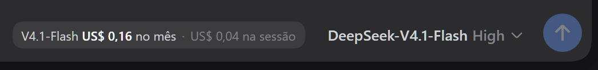

# dsh-plugin-cost-meter

[](https://github.com/luizabgk/dsh-plugin-cost-meter/actions/workflows/ci.yml)

Mostra, **ao lado do nome do modelo** no composer da GUI do
[DeepSeek Harness](https://github.com/deepseek-ai/deepseek-harness), quanto o
modelo já custou:



- **no mês** — gasto estimado daquele modelo no mês corrente (UTC), zerando
  sozinho na virada do mês;
- **na sessão** — gasto estimado da conversa aberta, mesmo que você troque de
  modelo no meio dela.

Passar o mouse abre um detalhamento: modelo selecionado, mês, sessão, os modelos
que **aquela sessão** realmente consumiu, e a origem/data da tabela de preços.

> **English:** a DeepSeek Harness web-client plugin that shows the estimated cost
> in USD (current month per model + current session) right next to the model name
> in the composer. Costs come from the real tokens the harness logs, priced with
> the official DeepSeek price table, which the host re-fetches daily.

## Por que não é "o gasto do cartão"

A API da DeepSeek **não expõe gastos faturados nem cobranças do cartão**; a única
leitura de conta disponível é o saldo restante (`GET /user/balance`), que este
plugin deliberadamente **não** usa. O que ele mostra é uma **estimativa**:

> tokens reais medidos pelo DSH × tabela oficial de preços
> (<https://api-docs.deepseek.com/quick_start/pricing>).

## Como funciona

```
~/.dsh/sessions/**/session.v3.jsonl.zstd     logs de sessão (tokens + modelo)
        │
        │  lib/aggregate.mjs   descomprime os N frames zstd concatenados,
        │                      extrai as amostras de uso e atribui o modelo de
        ▼                      cada `request/header` → data.header.config.model
   costs.json ───────────┬───────────────────►  semente embutida em lib/client.js
        ▲                │
        │                └──►  rota GET /cost-meter/report.json
        │  lib/pricing.mjs baixa a página oficial            │
        │  (cache de 24 h em price-cache.json)               │ fetch a cada 10 s
   host: lib/host.mjs, reagrega a cada 30 s                  ▼
   (entrada: lib/index.js)                        badge no slot do composer
                                                  `conversation.input.right`
```

Duas fontes de dado:

1. **A rota do host** — é a **fonte da verdade**. O host lê *todos* os logs de
   sessão, recompõe os totais por modelo/mês e por sessão, e publica o resultado
   em `/cost-meter/report.json`. O browser só o consulta.
2. **A semente embutida no bundle** — o mesmo relatório no momento do build.
   Serve de valor inicial e de fallback se a rota ainda não respondeu.

O badge **não soma nada no browser**. Já existiu aqui um crédito incremental por
delta de tokens, e ele contava o mesmo gasto duas vezes (o host já incluía aquele
consumo). Se você for estender este plugin: **não recalcule custo no cliente**.

### Fluxo automático

| O quê | Quem faz | Quando |
|---|---|---|
| Tabela de preços oficial | host baixa a página | no boot, se o cache passar de 24 h |
| Totais por modelo/mês/sessão | host reagrega e publica na rota | a cada 30 s |
| Badge no browser | cliente consulta a rota | no mount e a cada 10 s |
| Nome do modelo / sessão atual | cliente relê do DOM e do slot | a cada 2 s |
| Virada de mês | host (UTC) | automática |

### Tarifas

| Por 1M tokens | `deepseek-flash` | `deepseek-v4-pro` |
|---|---|---|
| entrada (cache hit) | $0,003 off-peak / $0,006 peak | $0,022 / $0,044 |
| entrada (cache miss) | $0,15 / $0,30 | $0,66 / $1,32 |
| saída | $0,60 / $1,20 | $1,98 / $3,96 |

Peak = 01:00–04:00 e 06:00–10:00 UTC, de segunda a sexta. A faixa é decidida pelo
horário de **cada amostra de uso**, não pelo horário da consulta.

## Instalação

Clone e gere o bundle (o repositório versiona o bundle com **semente vazia**, para
não publicar dados de sessão de ninguém):

```sh
git clone https://github.com/luizabgk/dsh-plugin-cost-meter.git
cd dsh-plugin-cost-meter
npm run build          # gera lib/client.js com uma semente sem dados
```

**Requisito:** Node **22.15+** (ou 23.8+). O plugin descomprime os logs de sessão
com o `zstd` nativo do `node:zlib`, que não existe em versões anteriores. Isso
não é exigência extra deste plugin: o próprio DSH usa a API zstd do Node (e não
declara `engines`, então Node antigo falha com um erro obscuro — veja a
[discussão #4459](https://github.com/deepseek-ai/deepseek-harness/discussions/4459)).

Depois, escolha **um** dos dois caminhos:

### A) Como bundle do perfil (caminho oficial)

```sh
dsh plugin --profile web add /caminho/para/dsh-plugin-cost-meter
```

O DSH passa a lista de bundles do perfil a incluir este pacote, e o patch que ele
traz (`cordis.patch.yml` → `dsh.bundle.patch`) insere a linha do plugin. Requer
`pnpm` disponível (o comando encaminha para ele).

### B) Por caminho, sem `node_modules` (o que este pacote usa)

Adicione a linha ao patch do perfil (`~/.dsh/profiles/web/cordis.patch.yml`):

```yaml
- insert:
    - id: cost-meter
      name: ./packages/dsh-plugin-cost-meter/lib/index.js
```

…com o pacote em `~/.dsh/profiles/web/packages/dsh-plugin-cost-meter/`. Assim a
instalação depende só do patch e da pasta do pacote — **nada em `node_modules`**,
que é território do pnpm/DSH (ele mantém um diretório próprio de fallback de
módulos e remove links que não reconhece).

> **Detalhe que custa caro:** o `name` precisa apontar para o **arquivo**
> (`lib/index.js`). O Node ESM recusa import de diretório
> (`ERR_UNSUPPORTED_DIR_IMPORT`), e o erro só aparece quando o host sobe.

Por fim, reinicie o host e recarregue a página:

```sh
dsh web
```

O host monta o snapshot dos bundles do cliente **no boot**, então uma instalação
nova só aparece depois de reiniciá-lo.

## Desenvolvimento

| Comando | O que faz |
|---|---|
| `npm run build` | gera `lib/client.js` com semente **vazia** (seguro para versionar) |
| `node scripts/build-bundle.mjs` | gera o bundle com o **seu** relatório real como semente — ⚠️ **não faça commit disto**: essa versão contém seus ids de sessão e valores. Rode `npm run build` para voltar à semente vazia antes de commitar. |
| `npm test` | roda as duas suítes: contrato/render do cliente e agregação do host |
| `npm run check:pricing` | baixa a página oficial e confere o parser contra os preços embutidos |
| `npm run check:costs` | agrega os logs desta máquina e imprime os números |
| `node scripts/capture-screenshot.mjs <url> [saida] [--gif]` | regenera a imagem do README (PNG ou GIF animado) — neutraliza os valores antes de cada captura. O GIF precisa do `sharp` (o DSH já traz um emprestado). |

`npm test` não precisa de navegador. Os dois diagnósticos que **precisam** usam um
Chromium headless (`probe-browser.mjs`, `inspect-dom.mjs`); eles procuram o
executável em caminhos usuais e aceitam `CHROME_PATH` para apontar o seu:

```sh
CHROME_PATH=/usr/bin/chromium node scripts/probe-browser.mjs "http://127.0.0.1:3080/?token=..."
```

## Contrato de plugin de cliente (o que este projeto aprendeu na dor)

Regras do DSH validadas contra o navegador real — cada uma destas custou uma
sessão de depuração:

- `package.json` → **`dsh.client.inject`** precisa listar os pacotes de que o
  bundle depende (além de `platform: "web"`). Sem esse campo a linha do boot graph
  sai sem dependências e o kernel do cliente **nunca ativa o plugin** — o bundle é
  baixado, não dá erro, e nada acontece.
- O bundle se registra em `window.__ModuleLoader__.load({ id, factory })`, com o
  `id` **igual ao nome do pacote**, e exporta `{ apply, inject }`.
- **Nunca** chame `slots.register` direto num slot de outro pacote: os plugins
  ativam em paralelo e a declaração do pai pode não existir ainda
  (`slot "x" is not declared`). O padrão é
  `scope.slots.inject(nome, () => scope.slots.register(...))`.
- Em `ctx.inject(['slots'], cb)` o serviço chega como **propriedade**
  (`scope.slots`), não via `scope.get(...)`.
- **O `sessionId` vem da fábrica `inject` do slot** —
  `inject: (sessionId) => ({ sessionId })`. O DSH não escreve `data-session-id` em
  lugar nenhum; raspar o DOM deixa o custo da sessão **sempre zerado**.
- O slot `conversation.input.right` só é montado com `input !== undefined &&
  sessionId !== undefined`; no estado "hero" (sessão vazia) ele não existe.
- O componente **nunca** deve retornar `null` quando não reconhece o modelo: isso
  apaga o badge. Mostre US$ 0,00 e o nome real no tooltip.
- O rótulo do modelo muda de forma entre versões (`V4.1-Flash`,
  `V4-Flash-Vision-Exp`, `V4-Pro`…). O `priceIdOf` do bundle casa por nome exato,
  rótulo, contenção e, por fim, por **família** (`flash`/`pro`) — os nomes
  aposentados são cobrados como Flash.

## Scripts de diagnóstico

| Script | Para que serve |
|---|---|
| `scripts/inspect-usage.mjs` | audita as amostras de uso e detecta contagem dupla no log |
| `scripts/inspect-cost-math.mjs` | recalcula o custo a partir dos buckets de tokens |
| `scripts/inspect-dom.mjs` | mostra como (e se) a sessão aparece no DOM |
| `scripts/probe-browser.mjs` | abre a GUI num Chromium headless e confere o badge no DOM |
| `scripts/inspect-session.mjs`, `scripts/debug-*.mjs` | formatos do log de sessão e da tabela de preços |
| `scripts/install.mjs` | reparo: refaz a linha do patch e reembute a semente |

## Limitações conhecidas

- **É estimativa, não fatura.** Usa os tokens reportados pelo provedor e a tabela
  pública; promoções, créditos gratuitos e feriados chineses não entram.
- **Feriados chineses** contam como off-peak — a página oficial os lista em prosa,
  que o parser não interpreta.
- **Cache write** é cobrado como entrada normal: a API não publica tarifa própria
  de escrita de cache.
- **A rota é servida sem autenticação**, de propósito: o DSH só escuta em
  127.0.0.1 e a rota devolve apenas totais de custo/tokens, nunca credenciais. Ela
  recusa qualquer método que não `GET`/`HEAD`.
- **`costs.json`, `price-cache.json` e a semente do bundle contêm dados seus**
  (ids de sessão e valores gastos). Estão no `.gitignore` — não os versione.
- **`lib/client.js` é GERADO.** Edite `lib/client.template.js`; o marcador de
  semente aparece uma única vez no arquivo, na constante `SEED`.
- Se uma versão futura do DSH renomear o slot `conversation.input.right`, o badge
  some sem quebrar a GUI — confirme com `npm test` e ajuste o nome em
  `lib/client.template.js`.

## Contato

Dúvidas, bugs e sugestões: abra uma **issue** em
<https://github.com/luizabgk/dsh-plugin-cost-meter/issues>.

## Licença

MIT — veja [`LICENSE`](LICENSE).
